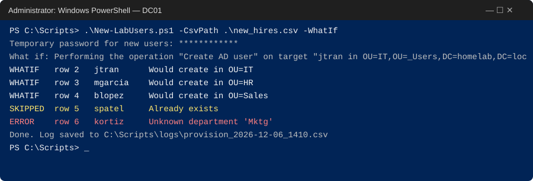
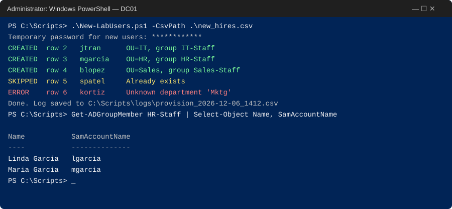
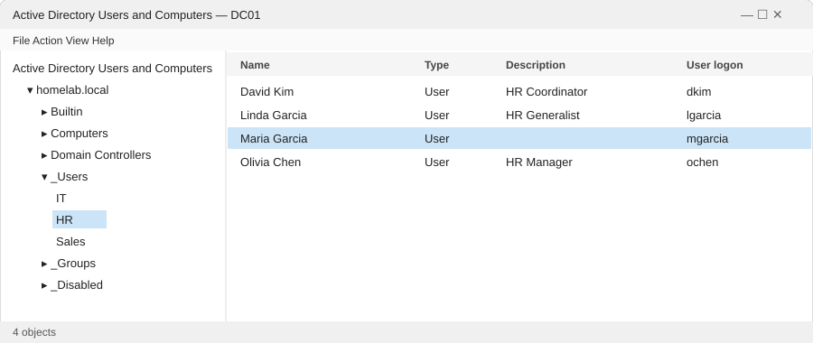
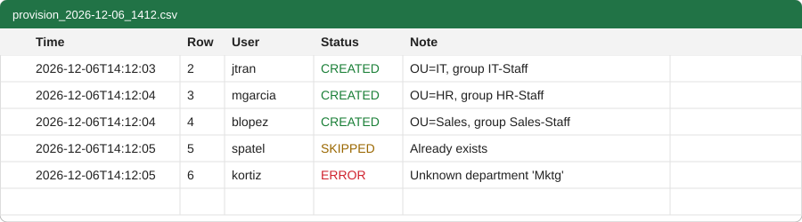

# AD User Provisioning Script

A PowerShell script that bulk-creates Active Directory user accounts from a CSV file, built for my Windows Server home lab (`homelab.local`).

Creating new hires one at a time in Active Directory Users and Computers is slow and easy to get wrong. This script sets every account up the same way, every time, and logs exactly what happened.

## What it does

- Reads `FirstName`, `LastName` and `Department` from a CSV
- Builds a username (first initial + last name) and **skips anyone who already exists**
- Places each user in their department's **OU** and **security group**
- Sets a temporary password and **forces a change at first login**
- Rejects unknown departments using an allow-list instead of guessing an OU path
- Logs every row as `CREATED`, `SKIPPED`, `ERROR` or `WHATIF` to a timestamped CSV
- Supports **`-WhatIf`** so you can test safely before changing anything in AD

## Requirements

- Windows Server with the **Active Directory** PowerShell module (RSAT), run on a domain controller or a domain-joined admin machine
- OUs `IT`, `HR` and `Sales` under an `_Users` OU, and groups `IT-Staff`, `HR-Staff` and `Sales-Staff`
  (edit the `$departments` table at the top of the script to match your domain)

## Usage

```powershell
# 1. Dry run: shows what would happen, changes nothing
.\New-LabUsers.ps1 -CsvPath .\new_hires.csv -WhatIf

# 2. Real run
.\New-LabUsers.ps1 -CsvPath .\new_hires.csv
```

You'll be prompted for the temporary password, so it's never stored in the script or the CSV.

### Example input (`new_hires.csv`)

```csv
FirstName,LastName,Department
James,Tran,IT
Maria,Garcia,HR
Brian,Lopez,Sales
Sarah,Patel,Sales
Kevin,Ortiz,Mktg
```

### Example output

```text
CREATED  row 2   jtran      OU=IT, group IT-Staff
CREATED  row 3   mgarcia    OU=HR, group HR-Staff
CREATED  row 4   blopez     OU=Sales, group Sales-Staff
SKIPPED  row 5   spatel     Already exists
ERROR    row 6   kortiz     Unknown department 'Mktg'
Done. Log saved to C:\Scripts\logs\provision_2026-12-06_1412.csv
```

## Screenshots


**Dry run with `-WhatIf`.** Nothing changes in Active Directory.



**Real run.** Valid rows are created, an existing user is skipped, and a bad department is rejected.



**Result in Active Directory Users and Computers.** The new user lands in the HR OU.



**Log file.** Every row is recorded with its outcome.



## Design decisions

- **`-ErrorAction Stop` on every AD cmdlet** so failures (like a group add) are caught and logged instead of silently reported as success.
- **Department allow-list** so a typo in the CSV is rejected, not turned into a broken OU path.
- **Dry run first.** `-WhatIf` is built in through `SupportsShouldProcess`.

## Related

Part of my IT home lab portfolio, alongside an Active Directory domain build and an osTicket help desk lab.
